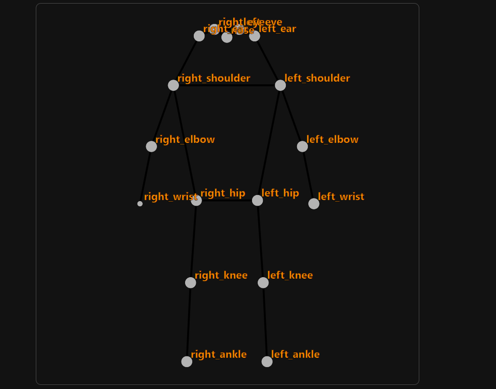
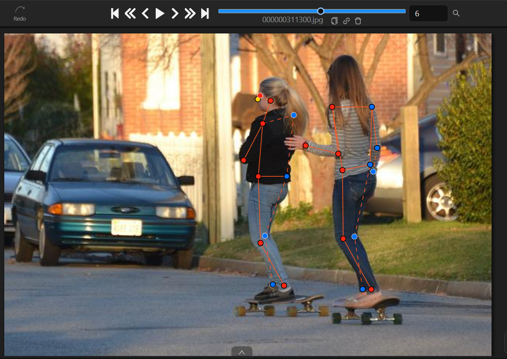
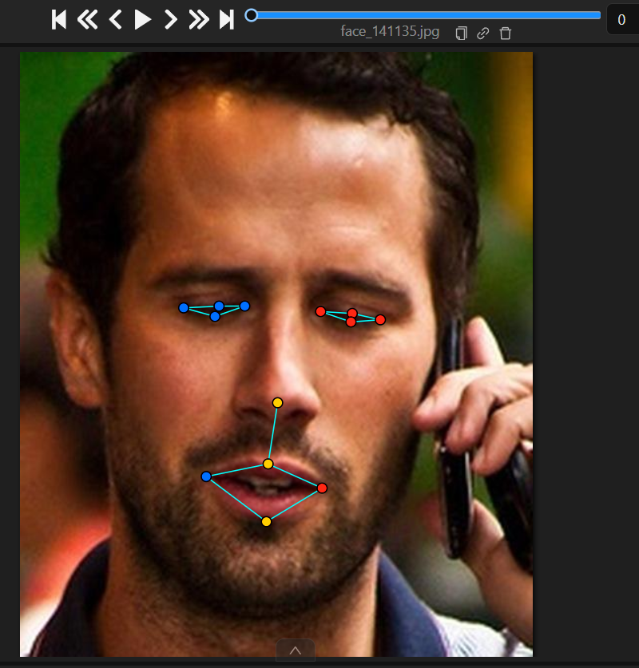
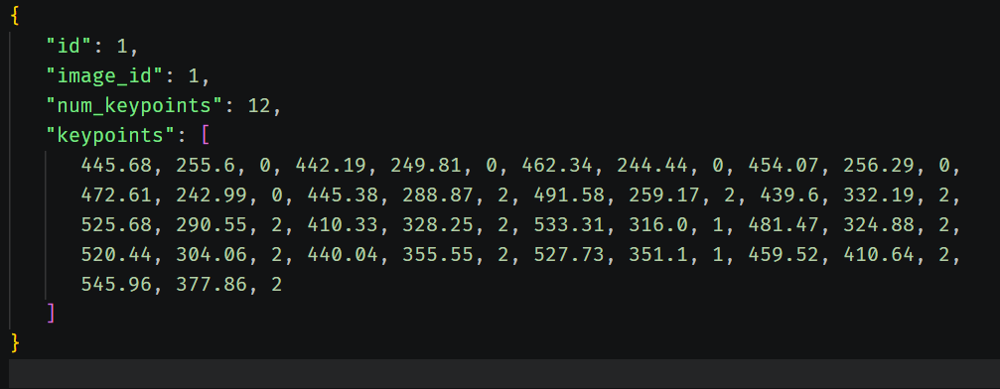

# Báo cáo cá nhân — Lê Việt Long — 2A202603043

Dữ liệu bài lab: 12 ảnh người từ bộ COCO và 8 ảnh khuôn mặt được phân theo MSSV. Nguồn ảnh và giấy phép cụ thể đối chiếu `src/lab/NGUON_ANH.md` và `src/lab/pool.json`.

> Báo cáo tổng hợp hai job CVAT đã hoàn tất và hai file xuất của Day 04. Thời gian thao tác, số đối tượng bỏ qua và lịch sử sửa nhãn cần xác nhận từ ghi chép thực hành.

## 0. Thông tin học viên

- **Họ tên:** Lê Việt Long
- **MSSV:** 2A202603043
- **Email:** 26ai.longlv3@vinuni.edu.vn
- **Link repository bài nộp:** https://github.com/DragVN04/K5-L2-DAY04-LeVietLong-2A202603043-KeypointPose (theo cấu hình Git local)
- **Phiên bản CVAT:** 2.74.1 (theo kết quả `python lab.py check`)
- **Máy:** Windows, chạy script qua môi trường có đường dẫn WSL; RAM Docker được cấp 9.6 GB; chế độ CVAT đầy đủ / lite: chưa ghi nhận
- **Bộ ảnh (`src/exports/assignment.json`):** `d04-k5-v2`, gồm 12 ảnh người và 8 ảnh khuôn mặt
- **Giờ bắt đầu:** Chưa ghi nhận
- **Giờ kết thúc:** Chưa ghi nhận

## 1. Kiểm tra label (CP0)

| Label    | Kiểu     | Số điểm | Tên điểm đúng bảng của lab? | Đúng thứ tự? | Số cạnh |
| -------- | -------- | ------: | --------------------------- | ------------ | ------: |
| `person` | Skeleton |      17 | có                          | có           |      19 |
| `face`   | Skeleton |      13 | có                          | có           |      13 |

- **Mẫu `person` dựng theo người quay mặt về camera (`left_*` nằm bên phải khung mẫu)?** Có. Skeleton được thiết kế theo tư thế người quay mặt về phía camera, do đó các keypoint `left_*` nằm bên phải ảnh theo góc nhìn của người gán nhãn.

- **Cách đổi cờ một điểm:** Rê chuột vào đúng keypoint cần chỉnh sửa, nhấn `Q` để bật/tắt `occluded` (`v = 1`) hoặc nhấn `O` để bật/tắt `outside` (`v = 0`). Sau khi chỉnh sửa, nhấn `Ctrl + S` để lưu annotation.

**Kết quả kiểm tra môi trường:** `python lab.py check` báo Docker 27.0.3, CVAT 2.74.1 tại `http://localhost:8080`, OPA đã nạp 445 quy tắc, còn 118.0 GB dung lượng trống và kết luận `CVAT sẵn sàng`.

## 2. Số lượng đã gán và thời gian (CP1, CP2)

| Nhóm ảnh   | Số ảnh theo đề | Số skeleton đã gán | Số người dưới 60 px (không gán) | Số poster / gương / màn hình bỏ qua | Thời gian (phút) |
| ---------- | -------------: | -----------------: | ------------------------------- | ----------------------------------- | ---------------- |
| `easy`     |              5 |                  5 | \_                              | \_                                  | Chưa ghi nhận    |
| `occluded` |              3 |                  6 | \_                              | \_                                  | Chưa ghi nhận    |
| `back`     |              2 |                  3 | \_                              | \_                                  | Chưa ghi nhận    |
| `small`    |              1 |                  1 | \_                              | \_                                  | Chưa ghi nhận    |
| `crowd`    |              1 |                  3 | \_                              | \_                                  | Chưa ghi nhận    |
| `faces`    |              8 |                  8 | —                               | \_                                  | Chưa ghi nhận    |
| **Tổng**   |         **20** |             **26** | —                               | —                                   | —                |

Số skeleton lấy từ hai bản xuất COCO Keypoints và được đối chiếu với mục **Info** trên CVAT. Nhóm ảnh người lấy theo `src/lab/pool.json` và bộ ảnh được giao trong `src/exports/assignment.json`. [Job #11 – Người](http://localhost:8080/tasks/11/jobs/11) · [Job #12 – Khuôn mặt](http://localhost:8080/tasks/12/jobs/12).

CVAT hiển thị thời lượng của cả job. Thời gian gán theo nhóm, mốc tiến độ phút 105 và ảnh tốn thời gian nhất cần bổ sung từ ghi chép lúc thực hành. Số đối tượng bỏ qua cần thống kê trên ảnh gốc.

## 3. Bảng ca khó (CP1, CP2)

Các trường hợp dưới đây được trích từ file xuất để đối chiếu với ảnh. Cột cuối nêu căn cứ cần kiểm tra khi chọn cờ.

| Ảnh                | Người / mặt | Điểm              | Cờ trong bản xuất | Cờ cần phân biệt | Căn cứ đối chiếu                                                                                                         |
| ------------------ | ----------- | ----------------- | ----------------- | ---------------- | ------------------------------------------------------------------------------------------------------------------------ |
| `000000311300.jpg` | Người #1    | `left_eye`        | `v=1`             | `v=1` / `v=0`    | Người quay lưng. Kiểm tra góc đầu và đường viền mặt để xác định vị trí mắt còn suy ra được hay đã khuất hẳn.             |
| `000000311300.jpg` | Người #2    | `right_wrist`     | `v=1`             | `v=1` / `v=0`    | Đối chiếu hướng cẳng tay trong vùng hai người chồng nhau để xác định còn đủ căn cứ đặt cổ tay hay không.                 |
| `000000012552.jpg` | Người #2    | `right_ankle`     | `v=0`             | `v=0` / `v=1`    | Ảnh đông người. Kiểm tra cẳng chân và vùng giao với người bên cạnh trước khi quyết định có thể suy ra cổ chân hay không. |
| `000000314154.jpg` | Người #1    | `left_ankle`      | `v=2`             | `v=0` / `v=2`    | Tọa độ nằm ngoài ảnh theo script. Cần kiểm tra rìa ảnh và đặt `v=0` nếu khớp thật ngoài khung.                           |
| `face_223746.jpg`  | Mặt #1      | `right_eye_inner` | `v=1`             | `v=1` / `v=0`    | Phóng to khóe mắt trong để kiểm tra vị trí có thể suy ra theo đường mí hay không.                                        |

## 4. Bảng tự review (CP3)

Bảng ghi kết quả kiểm file xuất ở năm ảnh người và ba ảnh mặt. Trạng thái sửa cần đối chiếu với lịch sử thao tác của học viên.

| Ảnh                | Người / mặt    | Điểm                               | Kết quả kiểm           | Ghi chú                                                                         | Đã sửa?           |
| ------------------ | -------------- | ---------------------------------- | ---------------------- | ------------------------------------------------------------------------------- | ----------------- |
| `000000012552.jpg` | Người #3       | Cặp cổ chân                        | Nghi `lr_swap`         | Cảnh báo từ script. Xem tư thế chân trong ảnh đông người.                       | Đã sửa            |
| `000000311300.jpg` | Người #1 và #2 | Cặp cổ chân                        | Nghi `lr_swap`         | Hai cảnh báo. Đối chiếu hướng cơ thể và chân trụ.                               | Đã sửa            |
| `000000359340.jpg` | Người #1       | `nose`, `right_eye`, `right_wrist` | Cần review trực quan   | Ba điểm có `v=0`; script không báo lỗi cho ảnh này.                             | Đã sửa            |
| `000000314154.jpg` | Người #1       | `left_ankle`, `right_ankle`        | `vis_flag`             | Cổ chân trái có tọa độ ngoài ảnh với `v=2`. Cổ chân phải sát mép, cần kiểm lại. | Lỗi còn trong ZIP |
| `000000220045.jpg` | Người #2       | Cặp hông                           | Nghi `lr_swap`         | Script báo cặp hông ngược phía so với các cặp còn lại.                          | Đã sửa            |
| `face_141135.jpg`  | Mặt #1         | 13 điểm                            | Qua kiểm tra định dạng | 13 điểm `v=2`. Vị trí khóe và mí mắt cần rà ở mức phóng to.                     | —                 |
| `face_223746.jpg`  | Mặt #1         | `right_eye_inner`                  | Cần review trực quan   | Có `v=1`; cần đối chiếu đường mí và khóe mắt.                                   | Đã sửa            |
| `face_476363.jpg`  | Mặt #1         | Hai khóe mắt phải, khóe miệng phải | Cần review trực quan   | Có ba điểm `v=1`; script không báo lỗi cho ảnh này.                             | Đã sửa            |

Script xác nhận một lỗi `vis_flag` trong file xuất. Năm cảnh báo trái/phải cần xem lại trên ảnh, gồm một cảnh báo ở ảnh `000000164659.jpg`. Một cảnh báo còn lại là cổ chân phải sát mép ở `000000314154.jpg`.

Điểm nên kiểm tra thêm là `left_eye` của người #1 ở `000000311300.jpg`. Giữ `v=1` khi có đủ dấu hiệu để ước lượng vị trí mắt bị che. Dùng `v=0` khi góc quay khiến vị trí mắt không xác định được.

## 5. Kiểm file xuất và kết quả tự kiểm (CP4)

Hai file ZIP trong `src/exports/` xuất theo định dạng COCO Keypoints 1.0. Mỗi ZIP chứa `annotations/person_keypoints_default.json`.

| File                     | Annotation đã kiểm    | Số phần tử `keypoints` | Số điểm theo cờ               | `num_keypoints` |
| ------------------------ | --------------------- | ---------------------: | ----------------------------- | --------------: |
| `LeVietLong_persons.zip` | `000000012552.jpg` #1 |                     51 | `v=0`: 5, `v=1`: 2, `v=2`: 10 |       12 (khớp) |
| `LeVietLong_persons.zip` | `000000314154.jpg` #1 |                     51 | `v=0`: 0, `v=1`: 2, `v=2`: 15 |       17 (khớp) |
| `LeVietLong_faces.zip`   | `face_141135.jpg` #1  |                     39 | `v=0`: 0, `v=1`: 0, `v=2`: 13 |       13 (khớp) |

Theo quy ước của lab, `outside` xuất thành `v=0` và `occluded` thành `v=1`. Script ghi nhận 63 điểm `v=0` vẫn giữ tọa độ cũ trong bản xuất.

CVAT hiển thị cả [job #11](http://localhost:8080/tasks/11/jobs/11) và [job #12](http://localhost:8080/tasks/12/jobs/12) ở trạng thái `completed`.

**Kết quả `src/check_submission.py`**

```text
- File person: LeVietLong_persons.zip
  Số ảnh: 12 · số skeleton `person`: 18 · mỗi annotation 51 số
  Skeleton theo ảnh: 000000012552=3, 000000030960=2, 000000091637=2, 000000164659=1, 000000196283=1, 000000220045=2, 000000311300=2, 000000314154=1, 000000359340=1, 000000429594=1, 000000433787=1, 000000438099=1
  Cờ v: v=2 209 (68%) · v=1 34 (11%) · v=0 63 (21%)
  num_keypoints trung bình: 13.5
- File face: LeVietLong_faces.zip
  Số ảnh: 8 · số skeleton `face`: 8 · mỗi annotation 39 số
  Skeleton theo ảnh: face_141135=1, face_223746=1, face_249336=1, face_279764=1, face_300399=1, face_476363=1, face_496353=1, face_99874=1
  Cờ v: v=2 92 (88%) · v=1 12 (12%) · v=0 0 (0%)
  num_keypoints trung bình: 13.0
- Ghi chú: 63 điểm v = 0 vẫn mang tọa độ cũ (CVAT 2.x xuất như vậy; chuẩn COCO ghi 0, 0). Không phải lỗi: điểm v = 0 bị bỏ qua khi huấn luyện và khi chấm.
- Số [LỖI]: 1 · số [CẢNH BÁO]: 6
Kết quả: CHƯA ĐẠT (1 lỗi). Sửa trên CVAT rồi xuất lại.
```

Script báo `left_ankle` ở người #1 trong `000000314154.jpg` có `v=2` tại (403, 433), nằm ngoài ảnh. Cần đối chiếu ảnh và đặt `outside` nếu khớp nằm ngoài khung. Sáu cảnh báo còn lại gồm năm trường hợp cần kiểm tra trái/phải và một điểm `right_ankle` sát mép ở cùng ảnh.

## 6. Ảnh minh chứng

1. Sơ đồ nhãn `person` trong Label Constructor của project `d04-keypoint`.

   

   Nguồn: CVAT, project #3.

2. Ảnh `000000311300.jpg` trong job #11, với bảng **Parts** đang mở ở người quay lưng.

   

   Nguồn: COCO 2017, chú thích trên CVAT.

3. Ảnh `face_141135.jpg` trong job #12, cắt quanh mắt và miệng để thấy các điểm.

   

   Nguồn: COCO 2017, chú thích trên CVAT.

4. Trích JSON của người #1 trong ảnh `000000012552.jpg`. Mảng có 51 số và `num_keypoints = 12`.

   

   Nguồn: `LeVietLong_persons.zip`, kết xuất thành ảnh từ JSON gốc.

## 7. Tự đánh giá

1. **Điểm cần chú ý khi rà nhãn.** Cặp trái/phải là nhóm bị script cảnh báo nhiều nhất. Nên xác định hướng cơ thể trước, sau đó lần theo vai, hông, gối và cổ chân của từng bên khi người quay lưng hoặc bắt chéo chân.
2. **Quy tắc có thể bổ sung vào guideline.** Khi một khớp nằm gần mép, kiểm tra phần cơ thể quanh khớp ở mức phóng to. Nếu vị trí thật nằm ngoài ảnh, đặt `outside`. Nếu khớp bị che nhưng còn suy ra được vị trí trong ảnh, đặt `occluded`.
3. **Ảnh hưởng tới model.** Với trường hợp `left_ankle` của ảnh `000000314154.jpg`, dùng `v=2` cho điểm ngoài khung có thể đưa một tọa độ ngoài vùng ảnh vào bước tạo heatmap. Tùy cách xử lý dữ liệu, heatmap có thể rỗng hoặc bị cắt ở biên trong khi điểm vẫn được tính vào loss. Gán `v=0` cho khớp thực sự ngoài ảnh cho phép loại điểm đó khỏi phần giám sát.

_Các nhận xét trên dựa vào bản xuất và kiểm tra tự động. Học viên cần xác nhận lỗi từng gặp và thao tác sửa trước khi nộp._

## 8. Khó khăn và lỗi kỹ thuật

- **Môi trường:** `python lab.py check` đã chạy thành công, không báo lỗi Docker/CVAT/OPA trong log đã cung cấp.
- Bản xuất người có lỗi visibility ở `left_ankle` của `000000314154.jpg`, xem mục 5. Các lỗi thao tác khác cần bổ sung từ ghi chép thực hành.

## Bonus

Chưa có dữ liệu bonus trong bộ file xuất.

## 9. Tài liệu tham khảo và công cụ AI đã dùng

1. VinUni-AI20k, _K5-L2-KeypointPose-Student_, `README.md`, `RULES.md`, `CHECKPOINTS.md`, `SUBMISSION.md`, `RUBRIC.md`.
2. VinUni-AI20k, `docs/GUIDELINE.md`, `docs/CVAT_CHEATSHEET.md`, `docs/COCO_KEYPOINTS.md`.
3. COCO dataset (Lin et al., 2014); nguồn và giấy phép từng ảnh đối chiếu danh mục nguồn trong repo.
4. ChatGPT hỗ trợ tổng hợp file xuất, đối chiếu CVAT, chụp minh chứng và soạn nhận xét dựa trên kết quả kiểm tra.
